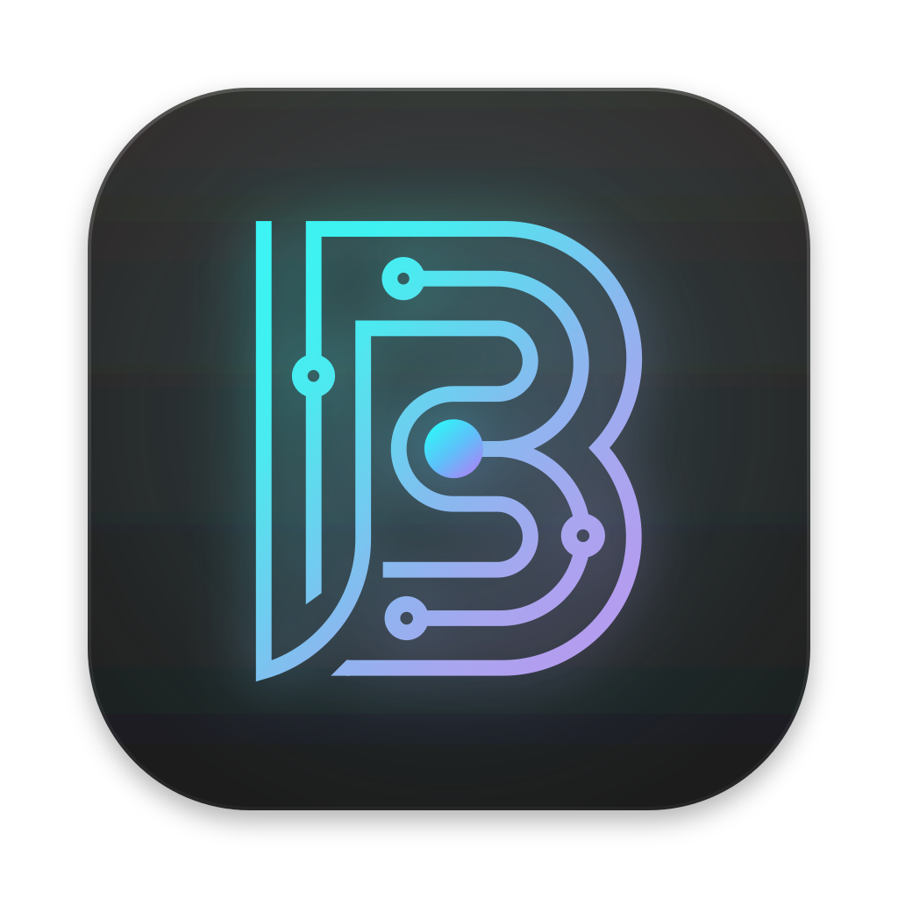
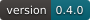
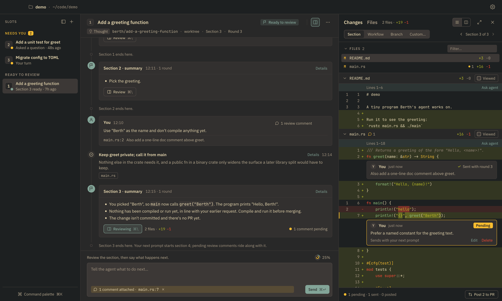

<div align="center">



# Berth

**Direct the agent. Review the result.**

[](https://github.com/giejqf/berth/actions/workflows/ci.yml)
[](https://github.com/giejqf/berth/releases)
[](#install)
[](docs/adr/0029-downloading-the-claude-agent-sdk.md)
[](LICENSE)

[Install](#install) ·
[How it works](#how-it-works) ·
[Releases](https://github.com/giejqf/berth/releases) ·
[Design](AGENTS.md)

</div>



Berth is a macOS app for agentic coding where you never touch code. You talk to
Claude Code, follow its decisions in an event flow, answer its questions, review
read-only diffs, and ship a PR. Every workflow runs in a **slot**: a worktree, a
container, a VM, or anything a `slot.sh` script can produce.

## How it works

- **A slot** is an isolated checkout where one agent works. Run several at once;
  the rail sorts them by what they need from you: an answer, a review, nothing yet.
- **A workflow** takes an issue, a pull request, a Linear or PostHog item, or a
  thought to an outcome, usually a PR, in rounds that end with a question, a
  summary or an outcome.
- **The event flow, not a transcript.** The agent records its decisions as it
  makes them, asks you questions on a card, and sums up each section. Subagents
  run in lanes of their own; the raw transcript is a click away.
- **Review** happens one section at a time, as read-only diffs with line comments
  the agent picks up with your next prompt. Berth never shows you an editor.
- **Agents work together.** One agent can ask for a new slot or tell another
  slot's agent what it needs; follow-ups become slots of their own.
- **Yours to shape**: slot types are scripts, connectors are a CLI and a skill,
  and agents can run on an OpenAI-compatible API through Berth's proxy.

## Install

Download the disk image for your Mac from
[Releases](https://github.com/giejqf/berth/releases) (`arm64` for Apple silicon,
`x86_64` for Intel), open it, and drag Berth into Applications. Berth is signed
and notarized by Apple. On first launch it downloads the Claude Agent SDK and
Claude Code (about 120 MB) from npm: they are Anthropic's, and not part of Berth.

You need:

- macOS 13 or later, and [Node.js](https://nodejs.org) 22 or later, which runs
  Berth's agents
- a Claude account, the Anthropic Console or a cloud platform for Claude Code
  (Berth opens Claude Code's own sign-in), or an `ANTHROPIC_API_KEY`
- the [GitHub CLI](https://cli.github.com), signed in (`gh auth login`), for
  issues, pull requests and comments

On first run Berth installs the `worktree` slot type into `~/.config/berth/slots/`.
More reference types (docker, Lima VM) live in [`slots/examples/`](slots/examples).

| Shortcut | Action |
|---|---|
| ⌘N | New workflow: a thought, a GitHub issue or PR, a connector's item |
| ⌘↩ | Send a prompt or an answer |
| ⌘. | Interrupt the agent |
| ⌘\\ · ⌘⇧E | Show the review pane · expand it over the flow |
| J / K · N / P | Next / previous hunk · file, in the diff |
| ⌘1–9 · ⌘⇧] / ⌘⇧[ | Go to a slot · the next / previous one |
| ⌘⇧A | Jump to the slot that needs you |
| ⌘K | Command palette: every action and its keys |

## Development

[`AGENTS.md`](AGENTS.md) is the source of truth for design and conventions;
[`docs/adr/`](docs/adr) records decisions. You need Rust (stable), Node 22+, pnpm
and [`just`](https://github.com/casey/just).

```sh
just setup              # pnpm deps, connector CLIs, git hooks
just dev ~/code/myrepo  # run the app on a repository
just test               # Rust + sidecar tests
just lint               # fmt, clippy -D warnings, eslint + tsc
just test-e2e           # one real Claude Code round (spends tokens)
just bundle             # dist/Berth.app (signed ad hoc)
just dmg                # dist/Berth-<version>-<arch>.dmg, drag-to-install
just readme-images      # docs/images: the badges and the logo, from their sources
just readme-screenshot  # docs/images/berth.png, from a seeded demo
```

To sign and notarize a release build, name a Developer ID identity and a
`notarytool` keychain profile: `BERTH_SIGN_IDENTITY="Developer ID Application: …"
BERTH_NOTARY_PROFILE=<profile> just dmg` (see AGENTS.md §12.1).

`just dev-tools` builds with the `devtools` feature: set `BERTH_DEV_SCRIPT` to a
script of UI steps and `BERTH_DEV_SHOTS` to a directory for window screenshots
(see `crates/berth-app/src/devtools.rs`). Use `BERTH_HOME` and `BERTH_CONFIG_DIR` to
keep experiments out of your real data.

## License

MIT. The app also ships third-party software under its own licenses, listed in
[THIRD-PARTY-NOTICES.md](THIRD-PARTY-NOTICES.md). The Claude Agent SDK and Claude
Code are not part of it: Berth downloads them from npm, under Anthropic's terms
([ADR 0029](docs/adr/0029-downloading-the-claude-agent-sdk.md)).
